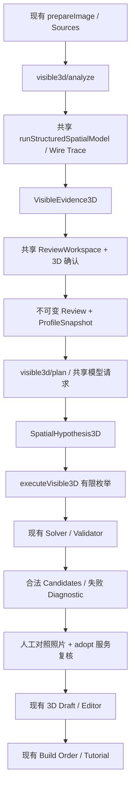

# Phase 5B V1 — Visible 3D Reconstruction

后续 Vision Spatial Understanding V2 的实现、真实照片结果和 Usage 见 [magnetic-visible3d-v2.md](./magnetic-visible3d-v2.md)。本页保留 V1 阶段历史验收记录。

本阶段已实现可操作闭环：照片/人工可见证据 → 独立 3D Vision Analysis → 人工 Review → Spatial Hypothesis → 确定性几何执行 → 多个局部或完整 Candidates → 明确采用 → 原有 Assembly3D Editor。采用后可继续 Phase 5A Build Order 与 Phase 4 Tutorial。

实现不补全不可见零件，不调用模型直接生成最终 XYZ/Quaternion，不修改原有 2D Prompt、2D 几何、LEGO Viewer 或 Phase 1–4 Schema。本次没有真实 Vision/LLM 调用，没有真实照片准确率结论。

## 实际复用及边界

| 来源 | 实际代码复用 | 本地适配 |
|---|---|---|
| DUPLO Spatial Planning runner | 将原 runner 的单次请求、Trace 初始化/落盘、完整性判断及失败记录提取到 `server/spatial-model-run.mjs`；原 `experiments/spatial-planning/runner.mjs` 直接调用它 | 通过小型 contract 传入 Prompt、任务类型、结构化校验；保留 DUPLO 原 Prompt 版本检查和状态语义 |
| DUPLO Workflow operation | 原 `brick-spatial-workflow.mjs` 的 requestId、输入指纹、exclusive write、运行/完成/失败状态与防重逻辑提取为 `server/spatial-operation.mjs` | 两种工作流共同调用；崩溃后 running 不会自动重新计费 |
| Provider 与 Trace | 直接调用 `brick-model-registry.mjs`、`brick-model-call.mjs`、`brick-vision-wire.mjs`、`openai-responses.mjs` | 使用独立 Visible 3D Prompt 与 schema；不复用 DUPLO 的 LDU、Stud、Yaw 或上下连接语义 |
| Magnetic 图片 Intake | 同一 `sources`/`assets`、`prepareImage()`、`intakeApi()`、Registry API、服务同源检查 | `visible3d/*` 子路由；数据独立存储；共享图片不代表共享 Analysis/Review/Selected |
| Magnetic Review | 直接复用 `intake/ReviewWorkspace.tsx` 的表、选择、搜索、筛选、可调整布局、原图区域 | 可选 spatial 模式禁用二维 outline matcher 和置信度伪评分；显示确认状态；右栏确认 Profile、颜色及连接证据 |
| Phase 1–3 | `adaptProfile()`、`solveAssembly3D()`、`validateAssembly3D()`、`MagnetScene3D`、现有 Editor 和 `saveDraft3D()` | 仅在边界转换数据；不改 Solver、Validator 算法和 Assembly3D Schema |
| DUPLO Geometry Execution | 沿用有限枚举、诊断与可采用候选分离、人工选择和来源复核模式 | 磁力片执行器独立实现约束枚举，实际几何运算完全使用现有 Magnetic Engine；没有复制砖块执行器 |

上游 vendored 代码未改动，原有 MIT License、UPSTREAM 和补丁记录保留。本阶段是应用边界模块，不新增第三方依赖。

## 调用链与源码

主要入口：

- `server/magnetic-intake.mjs`：在原 Intake 内挂载 `visible3d/`，沿用原图片和 Registry 存储。
- `server/magnetic-visible3d-vision.mjs`：两套独立 Prompt、Gemini/OpenAI 请求构造和本地契约验证。
- `server/magnetic-visible3d.mjs`：不可变记录、Review head、来源链、模型 Trace 复核、执行和采用。
- `src/magnetic-tiles/three-d/reconstruction/contracts.ts`：可见证据、人工 Review、空间假设和严格解析。
- `src/magnetic-tiles/three-d/reconstruction/execute.ts`：磁力片约束枚举与现有引擎桥接。
- `src/magnetic-tiles/three-d/reconstruction/Visible3DWorkflow.tsx`：现有三栏 Source/Review/Reconstruction 的 3D Controller 和入口。
- `StudioLayout.tsx`：独立 intakeMode、lazy loading、采用候选到现有 3D Editor 的明确操作。
- `three-d/ThreeDWorkspace.tsx`：接收已采用快照、沿用原 Draft 保存、展示照片来源。`reconstruction/adopt-draft.ts` 在 CAS/存储失败时保留原草稿来源。

## 数据契约

四层信息分开存放，不能把模型输出当作照片事实：

1. **VisibleEvidence3D**：模型声称观察到的可见证据（或明确标注为人工导入）。每个 Observation 保留独立 ID、近似颜色、可空 bbox、局部角点/边段、visible/estimated 标记、遮挡、文字证据、不确定性及准确 Profile ID@Version 候选。bbox 是可见区域，不是完整零件尺寸。坐标采用显示方向归一化后的图片坐标，左上角 0,0。
2. **VisibleReview3D**：保留所有 Observation，用 excluded 排除而非删除证据；confirmed 是用户确认。Profile 可以是 null/null，不能伪造尺寸。人工选择的 Profile 由服务端从当前版本化 Registry 捕获真实 vertices、connectableEdges、尺寸来源和厚度。保存后固定 confirmed 且未排除的实例集合。
3. **SpatialHypothesis3D**：parts 必须与固定实例及 Profile 完全一致；connections 包含准确端口或 null、角度候选/区间/Unknown、flip boolean/null、证据引用及不确定性。alternatives 是完整替代连接集合。occludes、projection_overlap、above_in_image 保留图片语义，不等于已校验的世界坐标关系。允许角点不完整、连接未知、多个组件。
4. **Reconstruction Candidate**：只存实际 Solver 生成、Validator 通过的 Assembly3D；完整 ProfileSnapshot 和最终 Pose 保留。独立记录 Geometry、Evidence Coverage、Photo Match 与 Human Review。

当前 Schema V1 每次最多 12 个可见 Observation，32 个局部特征/片、48 个连接/假设、8 个完整替代解释。不接受模型 XYZ、Quaternion、额外零件、DUPLO 网格字段或未知字段。

厚度当前由 Review 的统一 Profile 单位厚度输入指定（默认 0.06），不是视觉实测值；同一 Review 中共用该值。Profile 的尺寸若为 estimated，快照和候选风险说明都会保留该来源。当前 Registry 的单位为相对几何单位，不能宣称恢复了毫米标定。

## 候选、预算、排序与不确定性

- 主假设与 alternatives 分别执行；人工 Review 对同一零件对的连接约束优先，原模型计划和 Review 都不被改写。
- 具体端口 + 离散角度 + flip 枚举形成 Connection Graph，显式调用现有 `solveAssembly3D()`，随后 `validateAssembly3D()` 检查真实 Pose、端口、碰撞、闭环等。
- 连续角度区间只采样端点和中点，保留“未穷尽区间”提示。Unknown 端口或角度不会默认为 0/90；Unknown flip 显式枚举 false/true 并标注为假设。
- 断开的组件没有照片标定给出的相对平移/深度。V1 **分别生成局部组件候选**，不任意挪开零件来制造合法整体。未采用组件、Unknown Profile 和未确认观察保留在 unresolved 中，排除项单列。可明确接受局部结果后到 Editor 人工继续编辑。
- 每个局部组件使用常规局部坐标系，根片单位 Quaternion。世界朝向、绝对位置、相机、尺度标定不属于本阶段已验证结论；模型 orientationEvidence 保留供人工审核，不能当作已满足的姿态约束。
- 默认组合预算 128、几何检查预算 256、topK 5；服务端硬上限分别为 2048、4096、20。计数和失败原因直接可见。预算耗尽不提供可直接采用的候选，不将不完整搜索伪装成成功。
- 只在有限离散搜索完成后，对合法候选按已重建数量降序、未验证项数量升序及稳定几何 JSON 排序；确定输入有确定输出。这不是照片相似度排序，也不宣称全局最优。
- 碰撞/错误闭环只产生 `GEOMETRY_REJECTED` / `SOLVER_REJECTED` Diagnostic，不进入合法候选列表。`separate` 和图片关系若缺少可执行位姿约束，明确留为未验证。
- `photoMatch={status:'unverified',score:null}`。人工勾选会在 Origin 写入 humanReview accepted，**不会把它改成自动照片匹配通过**。未实现相机标定/重投影，不提供虚构评分。Geometry Valid 不代表物理稳定或现实容易搭建。

## Trace、过期保护与保存

服务端新增记录全部位于 `generated/magnetic-intake/visible3d/`，与 2D kinds/Selected 隔离：

- analyses → reviews → plans → executions → origins：不可变 UUID 记录，SHA-256 校验和逐级来源 Hash。
- model-traces：共享 runner 保存原请求/响应正文、原始输出、解析状态、provider/model/设置、finishReason 与源图片 Hash。只有响应完整、契约通过、Wire 已保存并与原输出一致才建立正式模型记录。手工导入明确标记 human-annotation / human-hypothesis，不伪造调用 Trace。
- requests：共享 requestId/输入指纹，重复相同请求返回原状态，不同输入复用 ID 拒绝；running/failed 不自动重试。`GET visible3d/requests` 可检查这些记录。
- heads：每来源一个 Review 当前修订，expectedRevision 并发检查；操作使用 exclusive lock。Review 变化后旧 Plan/Execution 标记 Outdated。前端未保存 Review 修改也立即阻止采用。
- adopt：在服务端重新核对当前 head、来源链及模型 Trace，重跑同一确定性执行并比较候选内容，再次校验几何，要求明确照片审核。给采用快照分配新 Assembly ID，保持 Pose、ProfileSnapshot、颜色、Connections 不变。

浏览器仅在 `magnetic-visible3d-context.v1` 保存明确选定的记录 ID；刷新从服务器恢复并复核 head。3D Draft 仍使用原 `magnetic-tiles.assembly3d-draft.v1` 保存和 CAS，读取时不求解。来源放在 `magnetic-tiles.assembly3d-origin.v1` sidecar，绑定采用时精确 Assembly JSON；后续编辑会标注“已编辑，原照片关联仅供追溯”。不向严格 Assembly3D Schema 偷加字段。

支持导出 Evidence、Spatial Hypothesis 和完整来源记录；Evidence/Hypothesis 可经人工入口重新导入并在当前来源和 Review 下重新校验，不信任外来 Candidate 为合法。原 Editor 的 Assembly3D JSON 导出保持几何格式兼容；独立几何文件本身没有照片来源，跨设备留存来源应同时导出完整来源记录。当前没有跨设备自动还原整个历史数据库功能。

崩溃可能留下 Review head lock，需要检查后清理锁文件，不会通过超时自动夺锁。服务端数据写入失败、Provider 截断或 Wire 失败会保留错误状态，不回退到其他模型或偷偷重新计费。

## UI 操作和验收

1. `npm run dev`，打开 `magnetic-tiles.html`。在第一阶段选择 **Visible 3D**；2D 图片仍有独立入口。
2. 上传真实照片，选择已配置模型，点击 **Analyze Visible 3D（调用模型）**。没有凭据时按钮不能调用；也可展开人工标注入口导入 VisibleEvidence3D，以零付费验证确定性流程。
3. 在 Review 表选中每片，右栏确认可见实例、Profile ID@Version、颜色和厚度；不能确定就保持 Unknown，误识别项用“排除实例”。检查局部边角、遮挡、estimated 特征，不要求补完整轮廓。
4. 可展开“确认连接边 / 二面角”，选择准确实例和端口、角度候选及 flip；留空就是 Unknown。保存 **3D Review** 固定实例。
5. 进入 Reconstruction，点击 **Spatial Planning（调用模型）**；或展开人工 Hypothesis，准备模板、编辑 JSON 并保存新计划。模型不能改变已确认实例。
6. 点击 **Geometry Execution（不调用模型）**。查看组合和检查预算、Diagnostic、多个候选和 coverage；在 Viewer 选择零件、旋转/缩放/平移、Fit/Reset，与原图对照。
7. 勾选审核后明确采用到现有 Editor。会提示替换 3D Draft；有未保存修改仍可取消。保存/刷新后检查 Pose、Snapshot 和来源。进入 Build → 3D 教程可继续 Generate Build Order。
8. 修改 Review，回到 Reconstruction 应显示旧候选 Outdated 或要求重新规划，不能绕过提示采用。将预算设 0 应得到 budget_exhausted，原 3D Draft 不变。
9. 切回 **2D 图片 / 2D 查看 / 2D 教程**，确认原 Analysis、Review、Selected、Assembly 和教程未串用。

两片连接的离线验收应使用同一照片证据的 ±90° 或 flip 替代解释，确认可切换、人工判断照片对应关系；立方体作为几何压力测试应验证 6 片/12 条连接，而非只凭外观。真实照片若只看到立方体 3 面，Review 只能确认 3 面，不得为了“完整立方体”补 3 个隐藏面。

## 自动化测试和真实覆盖

| 检查 | 实际结果 |
|---|---|
| `npm run test:magnetic-3d` | 173/173 通过；其中 12 项新 Visible Reconstruction 测试 |
| `npm run test:magnetic-visible3d` | 7/7 通过；包含实际 Provider adapter + 被替换 HTTP transport 的 Analysis→Review→Planning→Execution，全 Wire Trace，无真实调用 |
| `node --experimental-strip-types --test test/magnetic-*.test.mjs test/brick-spatial-*.test.mjs test/brick-selected-spatial.test.mjs` | 171/171 通过，包含 2D、Registry、保存、DUPLO 空间工作流和选择保护 |
| `npm run typecheck:magnetic-3d` / `npm run build` | TypeScript 与生产构建通过；存在原有 Three.js bundle 大小提示 |
| `npm run test:magnetic-visible3d:browser` | 实际 Chrome/WebGL（截图像素确认零件已渲染）、临时 API/数据：两片候选、立方体、相机、显式采用、保存刷新、过期和预算拦截、下游 6 步 Build Order |
| `node --experimental-strip-types scripts/verify-magnetic-3d-viewer.mjs` | 原 3D Viewer 浏览器回归通过，含相机、选择、文件加载、快照一致性和移动布局 |
| `node --experimental-strip-types scripts/verify-magnetic-3d-editor.mjs` | 原 3D Editor 浏览器回归通过，含几何、Undo/Redo、保存和 2D 隔离 |
| `node --experimental-strip-types scripts/verify-magnetic-3d-tutorial.mjs` | 原 Tutorial 浏览器回归通过，含步骤、相机、播放、导入导出、保存恢复和来源隔离 |
| `npm run test:magnetic-visible3d:2d:browser` | 旧 2D Review 浏览器套件在临时 fixture 副本通过，保留原匹配评分、添加/删除/撤销、保存、刷新及三栏布局 |

新几何测试涵盖两片 90°、±号多解释、六片/12 边多闭环、三面空间结构、三角片/方片的局部小房子式结构、不同版本和尺寸/厚度、局部遮挡证据、Unknown Profile/Port/角度、断开组件、碰撞、错误闭环、预算耗尽及人工约束优先。

测试产物：`/tmp/magnetic-phase5b-browser/result.json`、`pair-candidate.png`、`cube-candidate.png`；原 Editor 产物沿用其脚本路径；2D 隔离结果 `/tmp/magnetic-review-ui/isolation.json`。

测试素材是由实际 Assembly 投影生成的合成 PNG、人工证据和既有 2D rose fixture；没有真实 3D 照片识别评估。仓库目前没有适合上述场景的真实 3D 照片基准。不能把这些通过数量解释为 Vision 成功率。

验收过程曾误运行默认连接本地开发服务的旧 2D Review 脚本，产生 4 条新的测试 Review；原 Analysis/Review/Selected 未变。已将这 4 条新增记录移出项目至 `/tmp/magnetic-phase5b-accidental-review-snapshots/`，并新增隔离 wrapper 后重跑通过。以后本阶段的 2D 浏览器验收使用上述隔离 npm 命令。

## 已知限制及下一步

- 真实 Vision/Planning 的输出质量、计费、Provider 在线 schema 接受情况仍需少量人工许可范围内的实际照片验证；本轮只验证离线 wire/结构化调用链。OpenAI 与 Gemini 请求均已构造测试，没有假定账户访问权限。
- 没有相机求解、重投影误差、绝对尺度、遮挡深度优化或任意根片世界朝向估计；因此不会自动宣布照片匹配。
- Unknown 无法形成可执行约束时输出局部结果；不能把多个分别合法的组件视为已恢复其整体相对位置。
- 角度连续区间只有限采样，失败不代表连续空间里不存在解。有限连接候选也不保证覆盖照片的全部解释。
- 人工精细修改空间替代解释目前使用 JSON；已有简单实例/Profile/连接表单，未建立第二套复杂 3D 编辑器。
- 没有完整自动识别可见边到 Profile port 的投影对应算法，端口对应由模型提出、人工确认，几何验证只确认它在提出的 3D 结构中合法。
- 不模拟物理稳定性、实际磁力或装配可达性；下游 Buildability Estimate 仍有 Phase 5A 的边界。
- 未开发镜像/对称/隐藏补全、Gallery、V4 或大型视觉重建框架。

下一步应收集 4–8 张少量真实图片：两片连接、三片结构、只见部分面的小房子、局部遮挡；逐张标注可见实例与边角，先评估计数、Profile 候选和连接假设的错误类型，再决定改 Prompt 或补少量投影约束。对于不同合法候选，让用户明确标记“与照片一致/不一致/仍未知”，以后再扩展可解释的照片匹配评估；不要先补隐藏零件或自由猜测结构。
